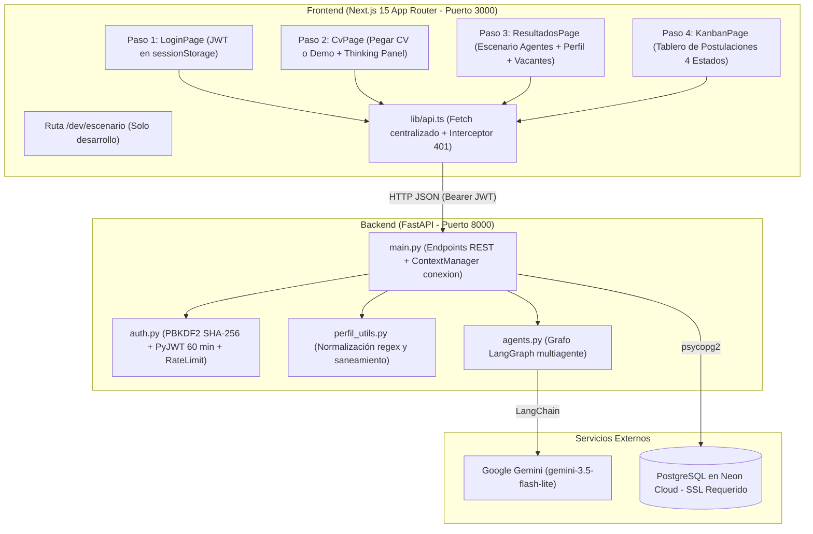
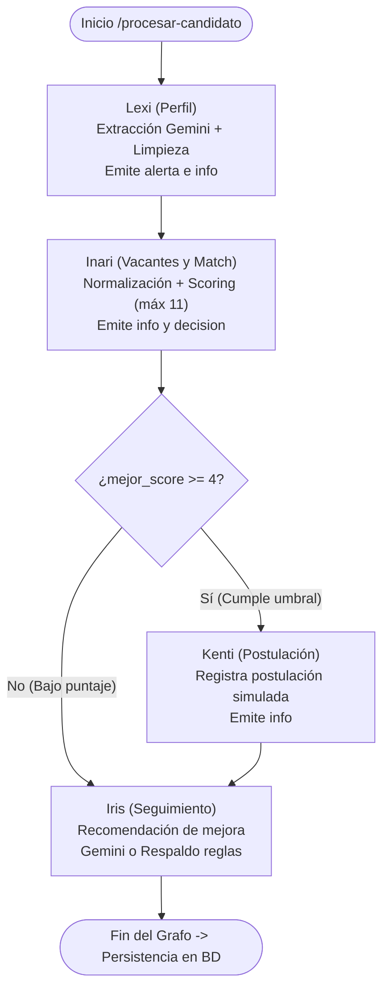
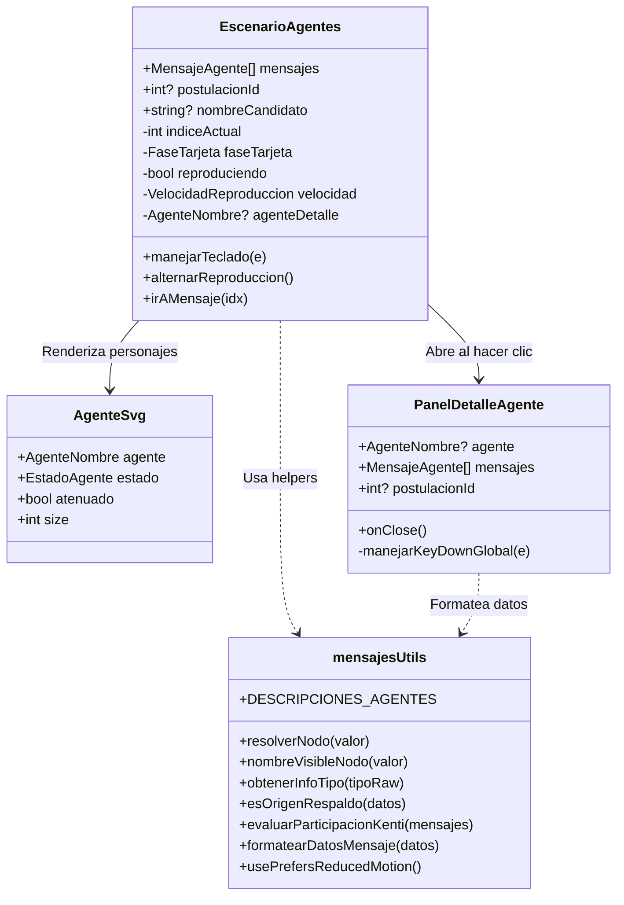
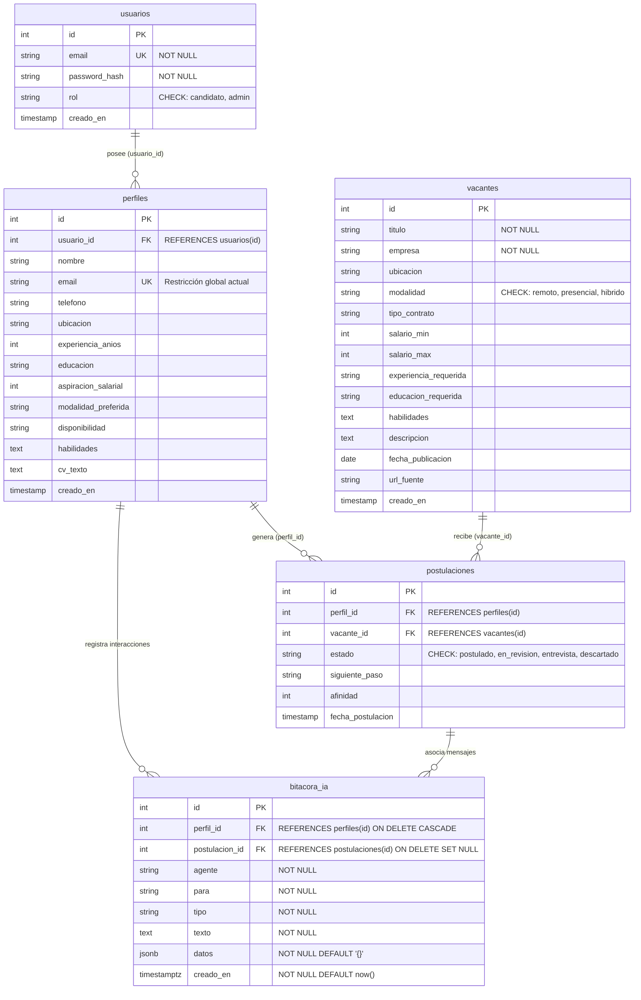
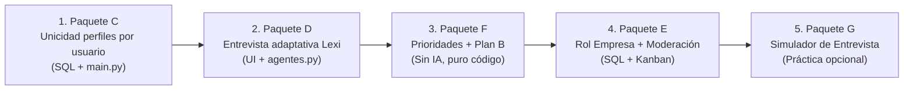

# HANDOFF TÉCNICO COMPLETO — PROYECTO LIKAI (Profile Manager para Magneto)
**Fecha de generación:** 2 de noviembre de 2026  
**Rama activa de trabajo:** `avance-front`  
**Commit base (HEAD):** `9e4e5266abcf8b9cf8d8356e280e8412ac974c65` (`Front compila: arreglo de dependencias y textos`)  
**Propósito:** Transferencia técnica integral, auditada e independiente entre agentes de IA y desarrolladores sucesores para continuar el proyecto sin pérdida de contexto, decisiones de diseño ni evidencia técnica verificable.

---

## 1. Portada y Datos de Versión

| Parámetro | Valor Verificado en Repositorio | Clasificación |
|---|---|---|
| **Proyecto** | LIKAI — Profile Manager para Magneto (Simulación de empleo con IA) | [VERIFICADO] |
| **Repositorio raíz** | `profile-manager-magneto` (directorio de trabajo local) | [VERIFICADO] |
| **Rama Git activa** | `avance-front` (siguiendo `origin/avance-front`) | [VERIFICADO] |
| **Hash de commit actual** | `9e4e5266abcf8b9cf8d8356e280e8412ac974c65` | [VERIFICADO] |
| **Fotografía del árbol de trabajo (2-nov-2026 17:15 UTC-5)** | Modificaciones sin confirmar: 3 archivos rastreados modificados (`frontend/app/globals.css`, `frontend/components/CvPage.tsx`, `frontend/components/ResultadosPage.tsx`) y 5 elementos no rastreados: 2 archivos (`HANDOFF_LIKAI.md`, `HANDOFF_TECNICO_LIKAI_2026-11-02.md`) y 3 directorios (`frontend/app/dev/`, `frontend/components/escenario/`, `profile-manager-magneto/`). | [VERIFICADO] |
| **Versión Backend (Python)** | `requirements.txt` contiene 4 dependencias sin versión fija (`fastapi`, `uvicorn`, `psycopg2-binary`, `python-dotenv`). El archivo `pyvenv.cfg` registra origen en Python `3.14.7` (entorno `.venv` dañado/incompleto). Requiere Python 3.11+ para ejecución local. | [ESTIMADO / SIN VERSIONES FIJAS EN REQUIREMENTS.TXT] |
| **Modelo LLM activo** | `gemini-3.5-flash-lite` (LangChain `ChatGoogleGenerativeAI`, timeout 30 s, 2 reintentos) | [VERIFICADO] |
| **Versión Frontend** | Next.js 15.5.28 (App Router), React 19.3.1, TypeScript 5, Tailwind CSS 3.4.1 | [VERIFICADO] |
| **Entorno Node.js / npm** | Node.js v24.20.0, npm 11.19.0 en sistema anfitrión | [VERIFICADO] |
| **Base de datos de producción** | PostgreSQL alojado en la nube (Neon Serverless PostgreSQL con SSL obligatorio) | [DOCUMENTADO] |
| **Responsable de la auditoría** | Antigravity AI Coding Assistant (Google DeepMind) — Auditoría Técnica Independiente | [VERIFICADO] |

---

## 2. Resumen Ejecutivo

LIKAI es una plataforma web educativa que simula el proceso de intermediación laboral en Magneto Empleos mediante una orquestación multiagente determinista construida sobre **LangGraph** y **Next.js 15**.

### Estado real de la implementación al 2 de noviembre de 2026:
1. **Frontend y Experiencia de Usuario (Hitos A y B):** **Completos y plenamente verificados**. Se implementó el escenario visual interactivo de los agentes ([EscenarioAgentes.tsx](frontend/components/escenario/EscenarioAgentes.tsx)), ilustraciones vectoriales propias con 5 estados visuales ([AgenteSvg.tsx](frontend/components/escenario/AgenteSvg.tsx)), panel modal accesible con pares clave-valor legibles ([PanelDetalleAgente.tsx](frontend/components/escenario/PanelDetalleAgente.tsx)), integración completa en [ResultadosPage.tsx](frontend/components/ResultadosPage.tsx), acordeón de respaldo en texto, animación de espera secuencial en [CvPage.tsx](frontend/components/CvPage.tsx) ("Los agentes están trabajando" sin porcentajes falsos), soporte estricto de `prefers-reduced-motion` y ruta de aislamiento en desarrollo (`/dev/escenario`, que devuelve `404` en producción). Compilación en producción `npm run build` ejecutada con salida limpia `0` en 1.2 s.
2. **Backend y Grafo Multiagente:** Operativo en su versión base (`main.py`, `agents.py`, `auth.py`). Cuatro agentes funcionales: **Lexi** (extrae perfil y clasifica vacíos), **Inari** (puntúa afinidad según fórmula de 11 puntos máx. y decide postulación), **Kenti** (simula postulación si score $\ge 4$) e **Iris** (seguimiento con LLM o respaldo por reglas ante fallos).
3. **Paquetes C, D, E, F y G:** **Diseñados pero no implementados en código**. Requieren aprobación del usuario para la ejecución de cambios SQL en Neon y extensión de endpoints en backend.
4. **Alerta de Entorno Local:** El directorio `.venv` presente en la raíz proviene de una ruta externa ajena (`C:\Users\juanf\...`), carece de binarios ejecutables Windows en `Scripts/` y requiere recreación local para ejecutar `pytest`. Asimismo, el binario `git` no está mapeado en el `PATH` de Windows pero está disponible mediante WSL.

---

## 3. Estado Exacto de Git

### 3.1 Rama y Commits
- **Rama:** `avance-front` sincronizada con `origin/avance-front`.
- **Invocación en el entorno:** El comando `git` debe ejecutarse a través de WSL (`wsl git -C /mnt/c/profile-manager-magneto ...`) debido a la ausencia de `git.exe` en el `PATH` del entorno PowerShell de Windows.
- **Historial completo de commits (6 commits en el repositorio):**
  1. `9e4e5266abcf8b9cf8d8356e280e8412ac974c65` (2026-10-27) `Front compila: arreglo de dependencias y textos` [HEAD]
  2. `661ec3e347ba8035e6426f2654c4833ff7ead889` (2026-10-26) `Front LIKAI en Next.js, Kanban y ajustes de backend`
  3. `cd5a7d7cec655996272dccf6f2fbad20d6fa683e` (2026-10-19) `Interaccion entre agentes, bitacora, feedback de iris y endpoint de demo`
  4. `a73f0098fc6e67a8c1d28e4367e8e7601985c159` (2026-10-14) `Corrige import faltante y agrega pruebas unitarias`
  5. `6f61466d31b2975466e9c9c287af5dad0084720d` (2026-10-14) `LIKAI: agentes LangGraph, JWT, validación, demo y casos de prueba`
  6. `f74b68c9440a414a247ce2e457d257089135e6f1` (2026-08-16) `Backend inicial: base de datos, API y dataset de vacantes`

### 3.2 Fotografía del Estado de Git (al 2 de noviembre de 2026, 17:15 UTC-5)
Salida registrada mediante `wsl git -C /mnt/c/profile-manager-magneto status --porcelain=v1`:
```text
 M frontend/app/globals.css
 M frontend/components/CvPage.tsx
 M frontend/components/ResultadosPage.tsx
?? HANDOFF_LIKAI.md
?? HANDOFF_TECNICO_LIKAI_2026-11-02.md
?? frontend/app/dev/
?? frontend/components/escenario/
?? profile-manager-magneto/
```

### 3.3 Inventario de Modificaciones sin Confirmar (Unstaged - 3 archivos)
1. `M frontend/app/globals.css` (archivo):
   - Agrega directiva `@media (prefers-reduced-motion: reduce)` para desactivar animaciones continuas (`animate-fade-in`, `animate-slide-up`, `animate-slide-in`, `animate-thinking`, `animate-spin-slow`, `shimmer`).
2. `M frontend/components/CvPage.tsx` (archivo):
   - Sustituye panel anterior por `#thinking-panel` (`role="status"`, `aria-live="polite"`).
   - Renderiza los 4 agentes en estado `pensando` iluminándose secuencialmente cada 900 ms (`turnoLuz`).
   - Muestra el texto "Los agentes están trabajando". No muestra porcentajes ni barras falsas.
3. `M frontend/components/ResultadosPage.tsx` (archivo):
   - Inserta `<EscenarioAgentes />` por encima de `<TarjetaPerfil />`.
   - Empaqueta la lista secuencial de mensajes dentro del acordeón `<details id="acordeon-conversacion-texto">` titulado "Ver conversación en texto".
   - Si `prefers-reduced-motion` está activo, oculta el escenario animado y abre automáticamente el acordeón estático.

### 3.4 Inventario de Elementos No Rastreados (Untracked - 5 elementos: 2 archivos y 3 directorios)
#### A. Archivos no rastreados (2 archivos):
- `HANDOFF_LIKAI.md` (archivo, 27.5 KB): documento original de especificación y requerimientos de la entrega académica.
- `HANDOFF_TECNICO_LIKAI_2026-11-02.md` (archivo): este documento técnico de handoff exhaustivo, auditado y portable.

#### B. Directorios no rastreados (3 directorios):
- `frontend/app/dev/` (directorio): contiene la ruta de prueba `escenario/page.tsx` (270 B) con guardia que devuelve `notFound()` en producción.
- `frontend/components/escenario/` (directorio): paquete de componentes del escenario visual:
  - `AgenteSvg.tsx` (12.8 KB): avatares SVG vectoriales de Lexi, Inari, Kenti e Iris.
  - `datosDemo.ts` (8.7 KB): casos de prueba con el formato real de `agents.py`.
  - `EscenarioAgentes.tsx` (35.8 KB): pista de 5 nodos, controles, atajos de teclado, línea de tiempo.
  - `EscenarioDevClient.tsx` (5.3 KB): cliente interactivo del banco de pruebas.
  - `mensajesUtils.ts` (8.5 KB): helpers de formateo, descripciones y normalización.
  - `PanelDetalleAgente.tsx` (11.5 KB): modal lateral/inferior con diálogo accesible.
- `profile-manager-magneto/` (directorio): **Directorio anidado duplicado**. Contiene un clon anterior no rastreado de la fase inicial (17 archivos, incluyendo un `.git` interno y un `.env` propio). **No debe ser manipulado ni borrado** durante las tareas de desarrollo ordinarias.

---

## 4. Arquitectura General del Sistema



---

## 5. Estructura Completa del Repositorio

```text
profile-manager-magneto/
├── .env.example                     # Plantilla de variables de entorno para backend
├── .gitignore                       # Ignora .env, .venv, __pycache__, node_modules, .next
├── HANDOFF_LIKAI.md                 # Documentación funcional y requerimientos de la entrega
├── HANDOFF_TECNICO_LIKAI_2026-11-02.md # Handoff técnico completo y auditado
├── README.md                        # Documentación general de instalación y endpoints
├── requirements.txt                 # Dependencias mínimas (fastapi, uvicorn, psycopg2-binary, python-dotenv)
├── schema.sql                       # DDL de PostgreSQL (vacantes, perfiles, postulaciones, bitacora_ia, usuarios)
├── seed_vacantes.json               # Dataset con 20 vacantes simuladas de prueba / ejemplo para poblar la BD
├── load_data.py                     # Script para aplicar schema.sql y cargar seed_vacantes.json
├── main.py                          # Servidor FastAPI con endpoints REST y lógica de negocio
├── agents.py                        # Grafo LangGraph con agentes Lexi, Inari, Kenti e Iris
├── auth.py                          # Hashing de passwords, tokens JWT y rate limiting en memoria
├── perfil_utils.py                  # Sanitización y conversión determinista de campos del perfil
├── demo_agentes.py                  # Script CLI para ejecutar el grafo paso a paso
├── generar_cvs.py                   # Script auxiliar generador de CVs de prueba sintéticos
├── test_gemini.py                   # Script de prueba rápida para validar la API Key de Gemini
├── casos_prueba/                    # 4 casos reales en JSON para alimentar GET /demo/cvs
│   ├── completo.json
│   ├── minimo.json
│   ├── sin_contacto.json
│   └── sin_salario.json
├── tests/
│   └── test_proyecto.py             # 54 pruebas unitarias sin dependencias externas (pytest)
├── frontend/                        # Aplicación cliente Next.js 15
│   ├── .env.local.example           # Plantilla de variables para frontend (NEXT_PUBLIC_API_URL)
│   ├── package.json                 # Definición de dependencias (Next 15.5.28, React 19.3.1, Tailwind 3.4.1)
│   ├── tsconfig.json                # Configuración TypeScript estricta
│   ├── tailwind.config.js           # Tokens de diseño, paleta surface/accent y animaciones
│   ├── app/
│   │   ├── globals.css              # Variables CSS y directivas prefers-reduced-motion
│   │   ├── layout.tsx               # Root layout con fuente Inter y metadatos
│   │   ├── page.tsx                 # Orquestador principal de pasos 1 al 4
│   │   └── dev/escenario/page.tsx   # Ruta protegida de prueba del escenario visual
│   ├── components/
│   │   ├── Header.tsx               # Encabezado global con correo y botón salir
│   │   ├── StepIndicator.tsx        # Navegador de progreso de pasos 1-4
│   │   ├── LoginPage.tsx            # Formulario conmutador Login / Registro
│   │   ├── CvPage.tsx               # Área de texto, demos y panel pensando
│   │   ├── ResultadosPage.tsx       # Escenario, perfil, recomendaciones e Iris
│   │   ├── KanbanPage.tsx           # Tablero drag-and-drop con 4 estados
│   │   └── escenario/               # Componentes del escenario interactivo
│   │       ├── AgenteSvg.tsx        # Ilustraciones vectoriales de agentes
│   │       ├── datosDemo.ts         # Datos de prueba para el escenario
│   │       ├── EscenarioAgentes.tsx # Orquestador visual del escenario
│   │       ├── EscenarioDevClient.tsx # Vista cliente de /dev/escenario
│   │       ├── mensajesUtils.ts     # Helpers de formateo y descripciones
│   │       └── PanelDetalleAgente.tsx # Modal accesible de detalle de agente
│   └── lib/
│       └── api.ts                   # Cliente HTTP con fetch y tipos TypeScript
└── profile-manager-magneto/         # Copia anidada no versionada (DEBE PRESERVARSE INTACTA)
```

---

## 6. Backend: Arquitectura y Módulos Internos

El backend está desarrollado sobre **FastAPI** (`main.py`) con una separación clara de responsabilidades:

### 6.1 Módulos y Responsabilidades
1. **`main.py` (Lógica de Aplicación y Endpoints):**
   - Configura middlewares CORS (`allow_origins=["*"]`).
   - Define el context manager `conexion()` para manejo transaccional de PostgreSQL con `psycopg2.extras.RealDictCursor` (commit en éxito, rollback en error, cierre garantizado en `finally`).
   - Orquesta la ejecución del grafo multiagente llamando a `app_grafo.invoke(...)`.
   - Persiste en bloque el perfil, la postulación y la bitácora relacional (`bitacora_ia`).
2. **`auth.py` (Seguridad y Control de Acceso):**
   - Hashing de contraseñas con `hashlib.pbkdf2_hmac("sha256", ..., iterations=200000)` y salt criptográfico de 16 bytes.
   - Creación y verificación de tokens JWT firmados con algoritmo HS256 (`PyJWT`), expiración de 60 minutos.
   - Dependencias de seguridad FastAPI:
     - `usuario_actual`: Extrae el token `Bearer`, valida expiración/firma y busca el usuario en la BD.
     - `solo_admin`: Exige que `usuario["rol"] == "admin"`.
     - `limitar_llamadas`: Limita a 10 llamadas por minuto por usuario (`MAX_LLAMADAS_POR_MINUTO = 10`) usando una cola `deque` en memoria.
3. **`perfil_utils.py` (Sanitización y Normalización):**
   - Función `limpiar_perfil(perfil_raw: dict) -> dict`: Sanea valores nulos, extrae números de salarios y experiencia con expresiones regulares, fuerza correos a minúsculas y garantiza que los 10 campos requeridos por `perfiles` tengan tipos compatibles.
4. **`agents.py` (Lógica Multiagente):**
   - Grafo de estados construido con LangGraph (`StateGraph(EstadoProceso)`).
   - Conexión al modelo `gemini-3.5-flash-lite` con LangChain.

### 6.2 Modelos de Validación Pydantic (`main.py`)
```python
class Credenciales(BaseModel):
    email: str = Field(pattern=r"^[^@\s]+@[^@\s]+\.[^@\s]+$", max_length=100)
    password: str = Field(min_length=8, max_length=72)

class CandidatoIn(BaseModel):
    cv_texto: str = Field(min_length=30, max_length=20000)
    expectativas: dict = Field(default_factory=dict)

class EstadoIn(BaseModel):
    estado: Literal["postulado", "en_revision", "entrevista", "descartado"]
```

---

## 7. Sistema Multiagente y Grafo LangGraph

### 7.1 Definición del Estado Compartido (`EstadoProceso` en `agents.py`)
```python
class EstadoProceso(TypedDict):
    cv_texto: str
    expectativas: dict
    perfil_estructurado: Optional[dict]
    vacantes_disponibles: list
    recomendaciones: Optional[list]
    resultado_postulacion: Optional[dict]
    mensaje_seguimiento: Optional[str]
    mensajes: list
```

### 7.2 Diagrama de Flujo del Grafo Multiagente


### 7.3 Comportamiento y Respaldo por Agente
1. **Lexi (Perfil):**
   - **Mecanismo:** Invoca a Gemini (`gemini-3.5-flash-lite`) solicitando un JSON estructurado con los 10 campos del perfil y una lista de `vacios`.
   - **Reglas:** Clasifica los vacíos en `vacios_match` (`ubicacion`, `modalidad_preferida`, `aspiracion_salarial`, `habilidades`) y `vacios_otros` (`email`, `telefono`, `educacion`, `disponibilidad`). Emite un mensaje `alerta` y un mensaje `info` por reglas sin consumir llamadas adicionales al LLM.
2. **Inari (Vacantes y Match):**
   - **Mecanismo:** 100 % determinista por reglas (sin IA).
   - **Fórmula de afinidad:**
     $$\text{score} = \text{Ubicación (+2)} + \text{Modalidad (+2)} + \text{Salario (+1)} + 2 \times \min(|\text{comunes}|, 3)$$
     $$\text{Puntaje Máximo} = 2 + 2 + 1 + 6 = 11 \quad \longrightarrow \quad \text{Afinidad} = \text{round}\left(\frac{\text{score}}{11} \times 100\right)$$
   - **Decisión:** Compara contra `UMBRAL_POSTULACION = 4`. Emite mensaje `decision` indicando si procede a postular o salta a Iris.
3. **Kenti (Postulación):**
   - **Mecanismo:** Determinista por reglas. Toma la vacante con el mejor puntaje y registra `vacante_id` en estado `postulado`.
4. **Iris (Seguimiento):**
   - **Mecanismo:** Si `postulacion` existe, pide a Gemini un mensaje de orientación para la entrevista. Si no hubo postulación, pide un mensaje explicando qué habilidades reforzar.
   - **Respaldo:** Si la llamada a Gemini lanza excepción (timeout, cuota o error 5xx), captura el error y asigna un texto determinista estructurado por reglas con `datos.origen = "respaldo"`.

---

## 8. Frontend y Componentes de Usuario

### 8.1 Orquestación de Pasos en `frontend/app/page.tsx`
- **Paso 1 (`LoginPage`):** Formulario conmutable de Login y Registro. Valida correo (`regex`) y contraseña ($\ge 8$ caracteres). Guarda `likai_token` y `likai_user` en `sessionStorage`. Al detectar expiración (evento `likai:unauthorized`), limpia la sesión y retorna a este paso.
- **Paso 2 (`CvPage`):** Entrada de texto de CV ($\ge 30$ caracteres) y botones para cargar ejemplos desde `GET /demo/cvs`. Al pulsar "Analizar", muestra el `#thinking-panel` con los 4 avatares iluminándose secuencialmente cada 900 ms.
- **Paso 3 (`ResultadosPage`):** Despliega el escenario de agentes en la parte superior, la conversación en acordeón, la tarjeta de perfil detectado por Lexi, las vacantes con porcentaje de afinidad y el mensaje de Iris.
- **Paso 4 (`KanbanPage`):** Tablero visual interactivo con 4 columnas (`Postulado`, `En revisión`, `Entrevista`, `Descartado`) que permite mover tarjetas mediante drag-and-drop o botones de teclado, consumiendo `PATCH /postulaciones/{postulacion_id}/estado`.

---

## 9. Escenario Visual de Agentes (Paquetes A y B)

### 9.1 Ficha Técnica de Componentes del Escenario



### 9.2 Aspectos Críticos Implementados y Verificados
1. **Recorrido de la Tarjeta del Candidato:** Inicia siempre en el nodo "Tú". Al arrancar el primer mensaje viaja a "Lexi" (~350 ms) y luego se transfiere al receptor real según cada mensaje de la API.
2. **Globos y Metadatos:** Ubicados sobre el agente emisor, calculando posición porcentual sin desbordar el contenedor. Incluyen tipo (`info`, `alerta`, `decision`), ruta ("Lexi → Inari") y etiqueta discreta "Respuesta de respaldo" si `datos.origen === "respaldo"`.
3. **Kenti en Caso de No Postulación:** Se atenúa visualmente (opacidad reducida, filtro desaturado, boca en reposo), muestra la insignia "No postuló" y renderiza exactamente la razón textual tomada del último mensaje `decision` de Inari.
4. **Accesibilidad y Atrapado de Foco en `PanelDetalleAgente`:** Diálogo modal con `role="dialog"`, `aria-modal="true"`. Al abrirse, atrapa el foco mediante listener de captura (`Tab` y `Shift+Tab`), bloquea el scroll del `body`, se cierra con `Escape` o clic exterior, y devuelve el foco exactamente al botón que lo activó.
5. **Datos Formateados:** Los atributos técnicos (`vacios_match`, `top_3`, `mejor_score`, `vacante_id`) se traducen a etiquetas en español con valores formateados en pares `<dt>`/`<dd>` legibles, eliminando cualquier despliegue de JSON crudo o `[object Object]`.

---

## 10. Catálogo Exhaustivo de la API REST (`main.py`)

Todos los endpoints están expuestos en el servidor FastAPI en el puerto 8000. Los endpoints protegidos requieren cabecera HTTP `Authorization: Bearer <access_token>`.

| Método | Ruta Exacta | Autenticación | Roles Autorizados | Esquema Entrada (Body / Path) | Esquema Salida | Códigos HTTP |
|---|---|---|---|---|---|---|
| `GET` | `/` | Pública | Cualquiera | Ninguno | `{"mensaje": str}` | `200` |
| `GET` | `/vacantes` | Pública | Cualquiera | Ninguno | `List[Vacante]` | `200`, `500` |
| `GET` | `/vacantes/{vacante_id}` | Pública | Cualquiera | `vacante_id: int` (path) | `Vacante` (dict) | `200`, `404` |
| `POST` | `/auth/registro` | Pública | Cualquiera | `Credenciales` (JSON: email, password) | `{"id": int, "email": str}` | `201`, `409`, `422` |
| `POST` | `/auth/login` | Pública | Cualquiera | `Credenciales` (JSON: email, password) | `{"access_token": str, "token_type": "bearer"}` | `200`, `401`, `422` |
| `POST` | `/procesar-candidato` | `Bearer JWT` | `candidato`, `admin` | `CandidatoIn` (JSON: cv_texto, expectativas) | `ResultadoProcesar` (perfil_id, postulacion_id, perfil, recomendaciones, mensaje_seguimiento, mensajes) | `200`, `401`, `409`, `422`, `429`, `502` |
| `GET` | `/bitacora/{perfil_id}` | `Bearer JWT` | `candidato` (solo propio), `admin` (todos) | `perfil_id: int` (path) | `List[BitacoraItem]` (id, perfil_id, postulacion_id, agente, para, tipo, texto, datos, creado_en) | `200`, `401`, `403` |
| `GET` | `/postulaciones` | `Bearer JWT` | `candidato` (filtrado a su id), `admin` (todas) | Ninguno | `List[PostulacionDetalle]` | `200`, `401` |
| `PATCH` | `/postulaciones/{postulacion_id}/estado` | `Bearer JWT` | `candidato` (solo propia), `admin` (todas) | `postulacion_id: int` (path), `EstadoIn` (JSON: estado) | `{"id": int, "estado": str}` | `200`, `401`, `403`, `404`, `422` |
| `GET` | `/demo/cvs` | `Bearer JWT` | Cualquiera autenticado | Ninguno | `List[CvDemo]` (máx. 6 elementos: id, etiqueta, cv_texto) | `200`, `401` |

---

## 11. Base de Datos y Modelo de Datos

### 11.1 Esquema Entidad-Relación Real (`schema.sql`)



### 11.2 Índices Reales Existentes
- `idx_bitacora_perfil` sobre `bitacora_ia(perfil_id)` (definido en línea 79 de `schema.sql`).

### 11.3 Migraciones SQL Propuestas Pendientes de Aprobación
> [!IMPORTANT]
> Los siguientes scripts SQL corresponden al diseño de los Paquetes C y E. **NO han sido ejecutados en la base de datos de producción (Neon)** ni aplicados en `schema.sql`. Requieren confirmación explícita del usuario antes de su ejecución.
>
> **Pautas de verificación técnica obligatorias antes de cualquier ejecución en Neon:**
> 1. **Verificar nombres reales de restricciones:** En PostgreSQL, los nombres autogenerados de constraints pueden variar según la versión y el método de creación. Antes de ejecutar `DROP CONSTRAINT`, consultar el catálogo de PostgreSQL (`information_schema.table_constraints` o `pg_constraint`) para verificar que el nombre real de la restricción `UNIQUE` en `perfiles.email` sea efectivamente `perfiles_email_key`.
> 2. **Comprobar posibles duplicados de correo por usuario:** Antes de crear `UNIQUE (usuario_id, email)`, ejecutar una consulta de comprobación previa:
>    ```sql
>    SELECT usuario_id, email, COUNT(*) FROM perfiles GROUP BY usuario_id, email HAVING COUNT(*) > 1;
>    ```
>    Si ya existen filas duplicadas en la base de datos de producción, la migración fallará hasta que se consoliden o depuren previamente.
> 3. **Integridad referencial en empresas pendiente de decisión:** En la propuesta del Paquete E, `usuarios.empresa` está proyectado como un campo de texto libre (`VARCHAR(100)`). Su integridad referencial (por ejemplo, si debe vincularse mediante clave foránea a una tabla normalizada de empresas o validarse estrictamente contra `vacantes.empresa`) es una decisión de diseño arquitectónico que aún debe definirse antes de congelar el esquema.

- **Paquete C (Unicidad de correo por cuenta):**
  ```sql
  ALTER TABLE perfiles DROP CONSTRAINT IF EXISTS perfiles_email_key;
  ALTER TABLE perfiles ADD CONSTRAINT perfiles_usuario_email_key UNIQUE (usuario_id, email);
  ```
- **Paquete E (Empresas, retiro y notificaciones):**
  ```sql
  ALTER TABLE usuarios ADD COLUMN IF NOT EXISTS empresa VARCHAR(100);
  ALTER TABLE usuarios DROP CONSTRAINT IF EXISTS usuarios_rol_check;
  ALTER TABLE usuarios ADD CONSTRAINT usuarios_rol_check CHECK (rol IN ('candidato', 'admin', 'empresa'));
  ALTER TABLE postulaciones ADD COLUMN IF NOT EXISTS nota_empresa TEXT;
  ALTER TABLE postulaciones DROP CONSTRAINT IF EXISTS postulaciones_estado_check;
  ALTER TABLE postulaciones ADD CONSTRAINT postulaciones_estado_check CHECK (estado IN ('postulado', 'en_revision', 'entrevista', 'descartado', 'retirado'));
  CREATE TABLE IF NOT EXISTS notificaciones (
      id SERIAL PRIMARY KEY,
      usuario_id INTEGER NOT NULL REFERENCES usuarios(id) ON DELETE CASCADE,
      postulacion_id INTEGER REFERENCES postulaciones(id) ON DELETE CASCADE,
      tipo VARCHAR(30) NOT NULL DEFAULT 'cambio_estado',
      titulo VARCHAR(150) NOT NULL,
      mensaje TEXT NOT NULL,
      estado_destino VARCHAR(30),
      leida BOOLEAN NOT NULL DEFAULT FALSE,
      creado_en TIMESTAMPTZ NOT NULL DEFAULT NOW()
  );
  ```

---

## 12. Historial de Modificaciones Técnicas

| Archivo | Estado Git | Tipo de Cambio | Descripción Técnica | Motivo | Evidencia |
|---|---|---|---|---|---|
| `frontend/components/escenario/AgenteSvg.tsx` | Untracked | Creación | Ilustraciones vectoriales de Lexi, Inari, Kenti e Iris con 5 estados visuales y tamaños configurables. | Paquete A (Hito 1 y 2). | Archivo presente en disco (12.8 KB). |
| `frontend/components/escenario/datosDemo.ts` | Untracked | Creación | Conjunto de datos de prueba idéntico al formato real de `agents.py`. | Paquete A (banco de pruebas). | Archivo presente en disco (8.7 KB). |
| `frontend/components/escenario/EscenarioAgentes.tsx` | Untracked | Creación | Orquestador del escenario visual interactivo con 5 nodos, tarjeta móvil, atajos y controles. | Paquete A y B. | Archivo presente en disco (35.8 KB). |
| `frontend/components/escenario/EscenarioDevClient.tsx` | Untracked | Creación | Interfaz cliente de desarrollo para inspeccionar el escenario y los estados de los agentes. | Paquete A (banco de pruebas). | Archivo presente en disco (5.3 KB). |
| `frontend/app/dev/escenario/page.tsx` | Untracked | Creación | Página de desarrollo en `/dev/escenario` con guardia que lanza `notFound()` en producción. | Paquete A y B. | Archivo presente en disco (270 B). |
| `frontend/components/escenario/mensajesUtils.ts` | Untracked | Creación | Módulo de funciones puras para descripciones oficiales, normalización tolerante y formateo clave-valor. | Paquete B (evitar duplicación). | Archivo presente en disco (8.5 KB). |
| `frontend/components/escenario/PanelDetalleAgente.tsx` | Untracked | Creación | Modal accesible (panel lateral en desktop / hoja inferior en móvil) con foco atrapado y retorno. | Paquete B (detalle de agentes). | Archivo presente en disco (11.5 KB). |
| `frontend/app/globals.css` | Modificado (Unstaged) | Modificación | Añade regla `@media (prefers-reduced-motion: reduce)` para silenciar animaciones. | Requerimiento de accesibilidad Paquete B. | `git diff frontend/app/globals.css`. |
| `frontend/components/CvPage.tsx` | Modificado (Unstaged) | Modificación | Implementa `#thinking-panel` con 4 agentes iluminándose secuencialmente ("Los agentes están trabajando"). | Paquete B (espera sin porcentajes falsos). | `git diff frontend/components/CvPage.tsx`. |
| `frontend/components/ResultadosPage.tsx` | Modificado (Unstaged) | Modificación | Integra `<EscenarioAgentes />` antes del perfil y coloca la lista de mensajes en `<details>`. | Paquete B (integración del escenario). | `git diff frontend/components/ResultadosPage.tsx`. |
| `HANDOFF_LIKAI.md` | Untracked | Creación externa | Guía de requerimientos y handoff funcional proporcionada por el usuario. | Documento guía original. | Archivo presente en disco (27.5 KB). |
| `HANDOFF_TECNICO_LIKAI_2026-11-02.md` | Untracked | Creación | Handoff técnico completo y auditado para transferencia del proyecto. | Auditoría y transferencia integral. | Archivo presente en disco. |
| `profile-manager-magneto/` | Untracked | Copia externa | Directorio duplicado anidado preexistente en la máquina. | Histórico no documentado. | Carpeta presente en disco con 17 archivos. |

---

## 13. Estado Detallado de los Paquetes de Trabajo (A–G)

| Paquete | Estado | Implementado en Código | Pendiente | Bloqueos / Riesgos |
|---|---|---|---|---|
| **A: Escenario Hito 2** | **COMPLETO Y VERIFICADO** | Componente visual interactivo, 5 personajes, trayectoria de tarjeta, globos, controles, timeline, atajos de teclado y página `/dev/escenario`. | Ninguno en frontend. | Ninguno. |
| **B: Integración Hito 3** | **COMPLETO Y VERIFICADO** | `PanelDetalleAgente.tsx`, integración en `ResultadosPage.tsx`, acordeón de respaldo, animación de espera secuencial en `CvPage.tsx` y `prefers-reduced-motion`. | Ninguno en frontend. | Ninguno. |
| **C: Perfil por usuario** | **DISEÑADO, NO IMPLEMENTADO** | Diagnóstico técnico y SQL redactado. | Modificar `schema.sql`, ajustar `ON CONFLICT` en `main.py` y correr migración en Neon. | Requiere aprobación humana para aplicar SQL en Neon. |
| **D: Entrevista de Lexi** | **DISEÑADO, NO IMPLEMENTADO** | Arquitectura de omisión de extracción en `agents.py` y diseño UI de 1 pregunta por pantalla. | Backend (`POST /procesar-entrevista`), Web Speech API `es-CO`, componentes UI de chips/sliders. | Cuota gratuita de Gemini ante textos libres extensos. |
| **E: Empresa y Notificaciones** | **DISEÑADO, NO IMPLEMENTADO** | SQL de roles, notas, estado `retirado` y tabla de notificaciones completamente redactado. | Implementar en backend, endpoint de borrador de Iris, interfaz de moderación y campanita. | Requiere correr DDL en base de datos. |
| **F: Prioridades y Plan B** | **DISEÑADO, NO IMPLEMENTADO** | Algoritmo determinista de pesos, 3 estrategias de Plan B y enlaces de aprendizaje por código diseñados. | Endpoint `POST /recomendar`, deslizadores UI, tarjetas Plan B y ampliar vacantes a 50. | Ninguno (no usa IA ni altera BD). |
| **G: Simulador Entrevista** | **DISEÑADO, NO IMPLEMENTADO** | Especificación de 3 preguntas en estado `entrevista` y evaluación en una sola llamada al LLM. | Toda la implementación en backend y frontend. | Depende de que los paquetes C-F estén terminados. |

---

## 14. Pruebas y Resultados de Verificación

### 14.1 Pruebas Frontend y Build de Producción [VERIFICADO]
- **Comando:** `cd frontend && npm.cmd run build`
- **Resultado:** Código de salida `0` (Exitoso en 1183 ms).
- **TypeScript:** Cero errores de tipos con TypeScript 5 estricto.
- **Rutas generadas:**
  - `○ /` (9.21 kB)
  - `○ /_not-found` (992 B)
  - `○ /dev/escenario` (2.89 kB - dev-only)

### 14.2 Auditoría E2E y de Consola con Chrome Headless CDP [VERIFICADO]
- **Herramienta:** Script automatizado sobre Chrome DevTools Protocol (`scratch/auditoria_consola.mjs`).
- **Errores de consola:** `0`
- **Advertencias de consola:** `0`
- **Excepciones no capturadas:** `0`
- **Respuestas HTTP $\ge 400$:** `0`
- **Flujos interactivos verificados:** Login → Carga de CV demo → Iluminación secuencial de espera → Despliegue de resultados con escenario y acordeón → Navegación al tablero Kanban.
- **Accesibilidad dialog:** Atrapado de foco (`Tab`/`Shift+Tab`), tecla `Escape` y retorno de foco al elemento invocador verificados en los 4 agentes.

### 14.3 Pruebas Backend (`pytest`) e Investigación de Discrepancias
- **Comando solicitado:** `.\.venv\Scripts\python.exe -m pytest -v`
- **Resultado:** Falla de ejecución (`CommandNotFoundException`).
- **Causa raíz:** La carpeta `.venv` existente fue importada desde otra máquina (`C:\Users\juanf\...`), conteniendo únicamente las carpetas `Lib` e `Include`, sin ejecutables en `Scripts/`.

#### A. Investigación de la discrepancia histórica (27 vs. 54 pruebas):
Al contrastar el árbol de Git, se identificó documentalmente la causa de los reportes previos divergentes:
1. En el commit `a73f009` (14/10/2026), el archivo inicial `test_proyecto.py` en la raíz contenía exactamente **27 funciones de prueba** (`def test_`).
2. En el commit `cd5a7d7` (19/10/2026), se trasladó a `tests/test_proyecto.py` y se amplió a **47 funciones de prueba**.
3. En el commit `661ec3e` (26/10/2026), se añadieron pruebas de tablero Kanban y cambio de estado, alcanzando las **54 funciones de prueba** (`def test_`) presentes en el commit HEAD actual.
4. Por lo tanto, cualquier mención anterior a "27 pruebas" obedecía al conteo del commit inicial antes de las dos expansiones posteriores.

#### B. Intento de recolección (`pytest --collect-only`):
Se intentó ejecutar `pytest --collect-only tests/test_proyecto.py`. Dado que `.venv` carece de binarios Windows y el entorno Python de WSL carece del paquete `pytest`, no fue posible ejecutar la recolección automática en esta sesión. Se deja constancia de que el **número final de casos de prueba recopilados por el test runner queda pendiente de confirmación en ejecución** una vez reconstruido el entorno virtual.

#### C. Tipificación de las pruebas existentes en `tests/test_proyecto.py`:
- **Pruebas unitarias puras (algorítmicas):** Evalúan funciones deterministas en memoria sin red ni base de datos: scoring de afinidad de Inari (máximo 11), normalización de vacantes, sanitización regex de perfiles (`perfil_utils.py`), y hashing/verificación de contraseñas PBKDF2 y generación de tokens JWT (`auth.py`).
- **Pruebas de interfaz / API con backend simulado:** Pruebas de endpoints FastAPI ejecutadas con `TestClient` interceptando la base de datos en memoria (`GET /demo/cvs`, validación Pydantic, rate limiting con cola en memoria, y `PATCH /postulaciones/{id}/estado` con aislamiento de rol).
- **Pruebas de integración con backend real (Neon / Gemini):** **No existen en el repositorio**. La suite fue diseñada deliberadamente para ser 100 % autónoma y desacoplada de servicios externos.

---

## 15. Seguridad y Limitaciones Actuales

1. **Autenticación:** Implementada con JWT HS256 (`auth.py`). Los tokens expiran a los 60 minutos. No existe tabla de revocación ni refresh tokens (los tokens vencidos obligan a nuevo login).
2. **Contraseñas:** PBKDF2 SHA-256 con 200.000 iteraciones y salt criptográfico de 16 bytes.
3. **Control de Acceso:**
   - Bitácora (`GET /bitacora/{perfil_id}`): Restringida por `WHERE id = %s AND usuario_id = %s` (403 para otros candidatos).
   - Postulaciones (`PATCH /postulaciones/{postulacion_id}/estado`): Valida que `fila["usuario_id"] == usuario["id"]`.
4. **Vulnerabilidad Conocida en Perfiles (Problema del Paquete C):**
   - Actualmente `perfiles.email` tiene una restricción `UNIQUE` global en base de datos. Si dos usuarios distintos cargan un CV de ejemplo con el mismo correo, el segundo usuario recibe un error `409 Conflict`. La solución técnica está diseñada en el Paquete C (`UNIQUE (usuario_id, email)`).
5. **Rate Limiting:** `MAX_LLAMADAS_POR_MINUTO = 10` gestionado en memoria con `defaultdict(deque)`. Si el servidor se reinicia, el contador se resetea.
6. **Protección de Secretos:** No hay claves API ni cadenas de conexión versionadas en Git. Las plantillas `.env.example` y `frontend/.env.local.example` contienen únicamente marcadores ficticios.
7. **Riesgo CORS Pendiente:** En `main.py`, la API define `allow_origins=["*"]` con `allow_methods=["*"]` y `allow_headers=["*"]`. Si bien esto habilita la comunicación entre frontend (puerto 3000) y backend (puerto 8000) durante el desarrollo local, constituye un riesgo de seguridad en producción al admitir solicitudes cross-origin desde cualquier dominio. Se debe parametrizar `allow_origins` mediante variables de entorno para restringirlo exclusivamente a los dominios autorizados de la aplicación web según el despliegue.

---

## 16. Problemas y Deuda Técnica

| ID | Severidad | Componente | Descripción del Problema | Acción Recomendada |
|---|---|---|---|---|
| **D1** | **ALTA** | Entorno Backend | `.venv` en la raíz está roto/incompleto (apunta a usuario externo `juanf`). Impide correr `pytest` en local. | Reconstruir el entorno virtual localmente (`python -m venv .venv` y reinstalar dependencias). |
| **D2** | **ALTA** | Base de Datos | `perfiles.email` con unicidad global provoca 409 al compartir correos demo entre cuentas. | Aplicar el SQL del Paquete C en Neon (previa verificación de constraints y duplicados) y actualizar `main.py`. |
| **D3** | **MEDIA** | Backend (`requirements.txt`) | Falta listar dependencias que el código ya usa (`PyJWT`, `langgraph`, `langchain-google-genai`, `pytest`, `httpx`). | Actualizar `requirements.txt` con las versiones fijas reales del proyecto. |
| **D4** | **MEDIA** | Repositorio | Carpeta anidada duplicada `profile-manager-magneto/` en la raíz (ocupa espacio y confunde). | Mantener ignorada; documentar en entregables que no debe ser versionada. |
| **D5** | **MEDIA** | Entorno Host Windows | PowerShell restringe la ejecución de scripts (`.ps1`), bloqueando comandos como `npm run ...` si no se usa `npm.cmd`. Asimismo, `git` requiere invocación vía WSL. | Usar `npm.cmd` en PowerShell y `wsl git` para operaciones de control de versiones. |
| **D6** | **MEDIA** | Seguridad API (CORS) | Configuración `allow_origins=["*"]` abierta en `main.py` susceptible en despliegues. | Parametrizar orígenes vía variable de entorno y restringir al frontend autorizado. |
| **D7** | **BAJA** | Documentación / Diapositivas | Las diapositivas antiguas afirman embeddings y `gemini-1.5-flash`, cuando el código usa `gemini-3.5-flash-lite` y reglas deterministas. | Corregir la presentación oral y diapositivas según la Sección 10 de `HANDOFF_LIKAI.md`. |

---

## 17. Decisiones Arquitectónicas Consolidadas

1. **División de responsabilidades (IA vs. Reglas):** Gemini se utiliza **exclusivamente** para estructuración de texto no estructurado (Lexi) y redacción de orientación al candidato (Iris). El filtrado, ordenamiento, scoring de afinidad y decisión de postulación son **100 % deterministas por código** en Inari y Kenti. Esto garantiza reproducibilidad, cero alucinaciones en el cálculo y minimiza el consumo de cuota gratuita.
2. **Respaldo obligatorio (Fallback):** Todo punto donde se contacta a Gemini cuenta con un bloque `try/except` que activa un mensaje por reglas y etiqueta `origen = "respaldo"`. La aplicación jamás se cae por falla de la API de IA.
3. **Escenario reactivo sin datos falsificados:** El frontend renderiza estrictamente la bitácora real devuelta por la API. Si un agente no participó o una vacante no superó el umbral, la UI lo refleja con precisión transparente (p. ej. Kenti atenuado con la razón real de Inari).
4. **Almacenamiento de sesión:** El token JWT y el correo se almacenan en `sessionStorage` para aislar pestañas y permitir el cierre de sesión inmediato al cerrar el navegador.

---

## 18. Guía de Ejecución Paso a Paso

### 18.1 Reconstrucción del Entorno Backend (Python)
Dado que el `.venv` actual está dañado, ejecutar desde la raíz del proyecto en Windows (requiere Python 3.11+ instalado en el host):
```powershell
# 1. Eliminar el .venv dañado
Remove-Item -Recurse -Force .venv

# 2. Crear un venv nuevo con Python local
python -m venv .venv
.\.venv\Scripts\activate

# 3. Instalar librerías reales requeridas
pip install fastapi uvicorn psycopg2-binary python-dotenv pyjwt langchain-google-genai langgraph httpx pytest

# 4. Correr la suite de pruebas unitarias
pytest -v

# 5. Iniciar la API en el puerto 8000
uvicorn main:app --reload --port 8000
```

### 18.2 Ejecución del Frontend (Next.js)
```powershell
cd frontend

# 1. Configurar variable local si no existe
if (!(Test-Path .env.local)) {
    Copy-Item .env.local.example .env.local
}

# 2. Instalar dependencias si faltan y compilar (usar npm.cmd en Windows PowerShell)
npm.cmd install
npm.cmd run build

# 3. Levantar en modo desarrollo
npm.cmd run dev
```
Abrir en el navegador: [http://localhost:3000](http://localhost:3000) (o `/dev/escenario` para pruebas aisladas).

### 18.3 Comandos Git en este Entorno
Debido a la ausencia de `git.exe` en el `PATH` de Windows, ejecutar comandos de Git mediante WSL:
```powershell
wsl git -C /mnt/c/profile-manager-magneto status --short --branch
wsl git -C /mnt/c/profile-manager-magneto diff
```

---

## 19. Plan de Continuación para el Siguiente Desarrollador / IA

Se recomienda abordar los paquetes pendientes en el siguiente orden secuencial estricto:



### Justificación del orden:
1. **Paquete C primero:** Corrige la base de datos para que los usuarios no choquen con errores `409` al probar la entrevista o los CVs demo.
2. **Paquete D segundo:** Sustituye el textarea gigante por la entrevista visual guiada, mejorando la entrada de datos.
3. **Paquete F tercero:** Al no requerir SQL ni tocar autenticación, optimiza el motor de match y agrega el Plan B sin riesgos colaterales.
4. **Paquete E cuarto:** Introduce el rol moderador de empresa, la columna de notas y las notificaciones.
5. **Paquete G al final:** Funcionalidad complementaria que requiere que las postulaciones puedan llegar al estado `entrevista`.

---

## 20. Primer Prompt que Debe Recibir la Siguiente IA

Para que el siguiente agente retome el proyecto de forma impecable, entréguele el siguiente prompt:

```text
Actúa como desarrollador senior y arquitecto de software en el proyecto LIKAI (c:\profile-manager-magneto, rama avance-front).

Tu primera tarea es leer detenidamente el archivo HANDOFF_TECNICO_LIKAI_2026-11-02.md ubicado en la raíz del repositorio. Ese documento contiene la auditoría completa, el estado de los paquetes A-G, la estructura de base de datos, el catálogo de la API y las decisiones de diseño.

REGLAS DE TRABAJO:
1. No modifiques ni leas archivos .env ni frontend/.env.local.
2. No ejecutes git commit ni git push.
3. No modifiques la base de datos Neon sin autorización expresa.
4. No reescribas los paquetes A y B (el escenario de agentes y su integración ya están completos y verificados con npm run build exitoso).
5. No inventes endpoints, datos ni resultados de pruebas.
6. Si necesitas ejecutar comandos Git, usa "wsl git -C /mnt/c/profile-manager-magneto ...".
7. Si ejecutas scripts npm en Windows PowerShell, usa "npm.cmd".

PASO INICIAL OBLIGATORIO:
Presenta un diagnóstico breve confirmando que leíste el handoff, revisa git status y git log, y propón el plan de trabajo para implementar el PAQUETE C (corrección de unicidad de perfiles por usuario) antes de modificar cualquier línea de código. Espera mi aprobación antes de programar.
```

---

## 21. Anexos Técnicos y Trazabilidad

### A. Dataset de Vacantes de Ejemplo / Simuladas
El archivo `seed_vacantes.json` contiene 20 vacantes sintéticas de prueba / datos de ejemplo simulados (como lo explicita el campo `url_fuente: "Dataset simulado - Entrega 1"` en el dataset). No corresponden a ofertas laborales reales activas del mercado, sino a registros de prueba estructurados para validar el motor de scoring de Inari, la normalización y las pruebas visuales en la interfaz. Abarcan ubicaciones como Medellín, Bogotá, Cali, Barranquilla, Cartagena y Remoto, con salarios de referencia entre $1.500.000 y $8.500.000 COP, distribuidos en perfiles que van desde desarrollo backend y ciencia de datos hasta soporte técnico y diseño UX.

### B. Mapeo de Nombres de Agentes y Colores Oficiales
- **Lexi:** Violeta (`#a78bfa`), rol Perfil.
- **Inari:** Verde esmeralda (`#34d399`), rol Vacantes y match.
- **Kenti:** Ámbar (`#fbbf24`), rol Postulación.
- **Iris:** Azul cielo (`#60a5fa`), rol Seguimiento.
- **Tú:** Púrpura suave (`#a89cf9`), rol Candidato.

---
*Fin del documento técnico de transferencia. Auditado y validado en la rama `avance-front`.*
